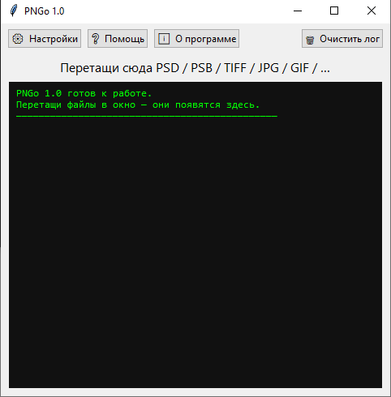
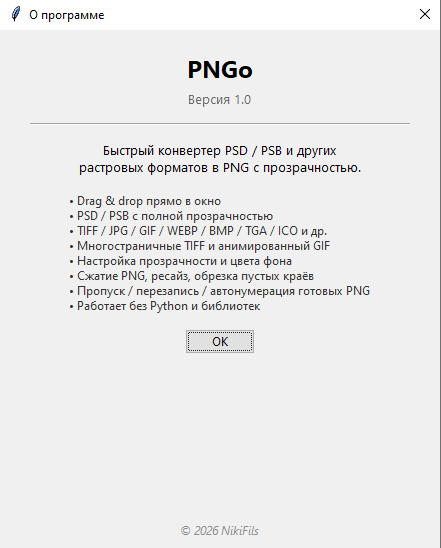

# PNGo

Drag & drop конвертер **PSD / PSB** и растровых изображений в **PNG с прозрачностью**.

Просто перетащи файл в окно программы — рядом с исходником появится PNG.

## Возможности

- Drag & drop — один файл или сразу пачка
- PSD / PSB с полной прозрачностью и склеенными слоями
- TIFF / JPG / GIF / WEBP / BMP / TGA / ICO / PCX / DDS / EPS и др.
- Многостраничный TIFF и анимированный GIF — постраничное сохранение (имя_1.png, имя_2.png, …)
- Настройки:
    - прозрачность вкл/выкл + цвет фона
    - сжатие PNG (0–9)
    - ресайз по длинной стороне
    - обрезка пустых прозрачных краёв
    - режимы при существующем PNG: перезапись / пропуск / автонумерация
    - суффикс к имени файла
- Опции интерфейса: подсказки, «всегда поверх», запоминание позиции окна

## Установка и запуск

Клонируй репозиторий:

    git clone https://github.com/NikiFils/PNGo.git
    cd PNGo

Установи зависимости:

    pip install -r requirements.txt

Запусти:

    python PNGo.py

## Системные требования

- Python 3.10+
- Windows 10 / 11, Linux или macOS
- Зависимости: psd-tools, Pillow, tkinterdnd2

## Известные ограничения

- Очень большие .psb (несколько ГБ) грузятся целиком в память
- Форматы без альфа-канала (JPG, BMP) сохраняются как непрозрачный PNG
- Скрытые слои PSD попадают в результат так, как сохранены в файле

## Лицензия

MIT © 2026 NikiFils